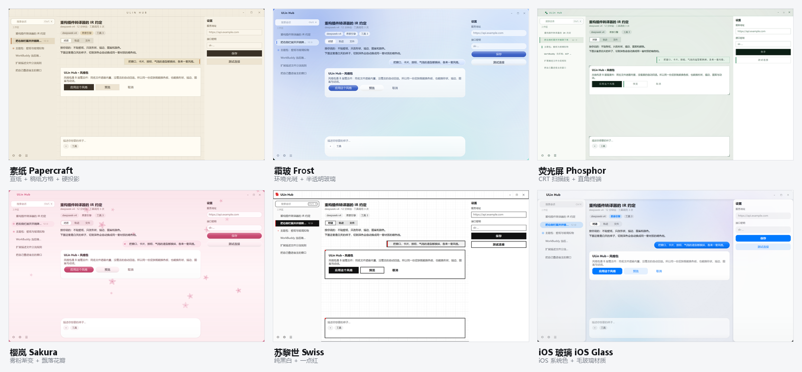
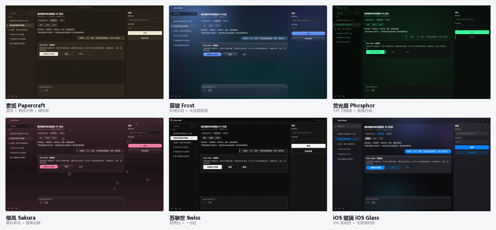

# ULin Hub 风格包

六套可直接装进客户端的界面风格包。每一套都**只改形状、描边、图案、颜色**，不贴壁纸图
（背景一律是自己用 `Canvas` 画的：有的画稿纸格，有的画极光渐变）：





| 包 | 一句话 | 形态 |
|---|---|---|
| [`papercraft`](papercraft/README.md) | **素纸** —— 宣纸底 + 稿纸方格 + 硬投影 | 方角、1px 墨线、印章式按压 |
| [`frost`](frost/README.md) | **霜玻** —— 冷蓝环境光斑 + 半透明玻璃面 | 大圆角、白高光边、柔光 |
| [`phosphor`](phosphor/README.md) | **荧光屏** —— CRT 终端 | 全直角、荧光绿、扫描线、四角角标 |
| [`sakura`](sakura/README.md) | **樱岚** —— 晨雾粉 + 飘落花瓣 | 胶囊、玫瑰渐变、柔边 |
| [`swiss`](swiss/README.md) | **苏黎世** —— 纯黑白 + 一点红 | 0 圆角、2px 硬描边、零阴影、版面网格 |
| [`ios`](ios/README.md) | **iOS 玻璃** —— systemColor + 毛玻璃材质 | 中性底 + 冷色云、贴边玻璃条、白卡片、tinted 按钮、iMessage 气泡 |

每套都带 light / dark 两份完整色板，所以切换深浅色时**风格不丢**。

- 素纸 light / dark → [`previews/light.png`](papercraft/previews/light.png) · [`previews/dark.png`](papercraft/previews/dark.png)
- 霜玻 light / dark → [`previews/light.png`](frost/previews/light.png) · [`previews/dark.png`](frost/previews/dark.png)
- 荧光屏 light / dark → [`previews/light.png`](phosphor/previews/light.png) · [`previews/dark.png`](phosphor/previews/dark.png)
- 樱岚 light / dark → [`previews/light.png`](sakura/previews/light.png) · [`previews/dark.png`](sakura/previews/dark.png)
- 苏黎世 light / dark → [`previews/light.png`](swiss/previews/light.png) · [`previews/dark.png`](swiss/previews/dark.png)
- iOS 玻璃 light / dark → [`previews/light.png`](ios/previews/light.png) · [`previews/dark.png`](ios/previews/dark.png)

> 预览图是用 [`misc/tools/stylepack-render`](../../misc/tools/stylepack-render) 里的离线渲染器渲出来的：
> 它把 `source/qml` 整棵树 + 包内覆盖件叠成一份 ui，再用 QML 单例替掉宿主那五个 C++ 单例
> （Theme / Style / WindowBridge / HostUi / Hub），最后用 `qml.exe` 渲染一张模拟界面。
> 不是真实客户端截图 —— 配色、圆角、描边、图案与实际安装后一致，只是没有真实会话数据。
>
> 改完包想重出预览：
>
> ```powershell
> python _build/gen_palettes.py            # 若改了色板参数
> python ..\..\misc\tools\stylepack-render\render_pack.py . dark previews\dark.png
> python _build\make_overview.py           # 重拼 overview-light/dark.png
> ```
>
> 渲染器默认找 `D:\Qt\6.11.2\msvc2022_64\bin\qml.exe`，别的机器上用环境变量 `QML_EXE` 指定。

## 装法

风格包 = `<exe>/ui/` 目录的**增量覆盖**：包内有的文件遮蔽内置件，包里没有的自动回退内置。

```powershell
# 逐个包叠加（powershell，路径按自己机器改）
Copy-Item -Path "assets\style-packs\papercraft\*" -Destination "x64\Release\ui\" -Recurse -Force
```

然后重启客户端（或 设置 → 外观 → 重置界面包 会丢掉覆盖、回到内置）。

换风格 = 用另一套的 `theme-*.json` + 覆盖件再盖一次。恢复默认 = 删掉 `<exe>/ui` 后重启（下次启动从 qrc 重新释放内置包）。

## 一个包里面有什么

```
papercraft/
  pack.json            uiAbi 必须= 3，否则整包被拒载（回退内置）
  README.md            这套改了什么
  theme-light.json     A 层：74 键调色板（浅色）
  theme-dark.json      A 层：74 键调色板（深色）
  metrics.json         A 层：圆角/字号/间距/尺寸/阴影/动效（覆盖层，缺键回退内置默认）
  skin/window/Backdrop.qml       B 层：窗口背景（图案层）
  skin/window/TitleBar.qml       B 层：标题栏
  widgets/Card.qml               B 层：通用卡片
  widgets/ActionButton.qml       B 层：全宽按钮
  skin/chat/UserBubble.qml       B 层：用户气泡
  skin/session/SessionRow.qml    B 层：会话行
  widgets/AppScrollBar.qml       B 层：滚动条（仅荧光屏覆盖）
  previews/light.png dark.png    预览图
```

### 私有件（C 层）

覆盖件可以带自己的**私有件**：不遮蔽任何内置文件，只被覆盖件相对 import。
宿主本来就支持这一层（`StyleResolver.h` 里写作 "C 层私有件 … 相对**包目录**解析"），
所以 `widgets/Card.qml` 可以写 `import "../skin/window"` 去用包里的 `Glass.qml`。

`ios` 是第一个用它的包：

```
ios/skin/window/Glass.qml        玻璃材质四层（折射 / tint / sheen / 双描边）
ios/skin/window/wallpaper.js     壁纸的唯一真源：中性底 + 四团冷色云（Backdrop 与 Glass 共用，所以颜色对齐）
ios/skin/window/grain.png        96×96 颗粒平铺图
```

想给别的包加私有件，照这个放法即可 —— 但**别把私有件放在 `widgets/`**，那个目录里的同名文件
会被当成覆盖件处理；放 `skin/<域>/` 下更清楚。

### 两条硬规矩

1. **色板必须整份**：`ThemeManager::loadPaletteFor()` 是整文件替换、不逐键合并。只写改过的那几个键，
   其余键在 QML 里是 `undefined`，颜色属性赋值失败后退回黑色 —— 症状是"每个控件一圈黑边、按钮变黑"。
   本仓库的 74 键由 [`_build/gen_palettes.py`](_build/gen_palettes.py) 从语义参数展开，永不漏键。
2. **覆盖件要保留原契约**：属性名、`signal`、`objectName`、`HostUi.registerItem` / `WindowBridge.addWindowControl`
   这类登记调用一个都不能少 —— 它们不是装饰，是宿主和扩展找得到这个控件的唯一途径。
   想改什么就改绘制那几行，别动 `property` / `signal` 声明。

### 为什么色板里没有 `_source` 这类说明键

`ThemeBridge` 会把调色板里**每个键**都当颜色解析，解析失败会刷
`[Theme] 调色板里的颜色解析失败，暂用品红占位` 警告。所以这些包的 JSON 里只有真实颜色键，
注释与设计说明一律写在 README。

## 自己改

- 只换配色：改 `theme-light.json` / `theme-dark.json`（保持 74 个键齐全）。
- 只换手感：改 `metrics.json` 的 `radius` / `shadow` / `font` / `motion`，**只列与内置不同的键就行**
  （这是覆盖层，缺的键回退 `ThemeBridge::default*` 的内置值）。
- 换形状/图案：改对应 B 层文件里画背景的那几个 `Rectangle` / `Canvas`，属性与信号原样留着。
- 想从零调一套新配色：在 `_build/gen_palettes.py` 里加一组 `pack_spec(...)`，跑
  `python _build/gen_palettes.py` 就展开成完整色板。脚本会以内置模板的键序输出，内置将来加键也不会漏。

## 限制

- 面板底色由 `basic/shell/Shell.qml` 用 `panelBg` 画；玻璃/半透明效果必须给色板的 `panelBg` / `cardBg` /
  `sessionBarBg` 写 `rgba(...)` 才透得出来（霜玻、素纸就是这么做的）。
- `Card` 的阴影画在卡片**底下**：半透明卡片会看到阴影透上来（霜玻在 light 下约暗 3%）。这是既有实现，
  想彻底解决要给 `MultiEffect` 加反相遮罩，不属于风格包的范围。
- 图片资源只用 PNG（发布包没有 `imageformats/`），背景层不要放 `MouseArea`（否则整窗点不动）。
