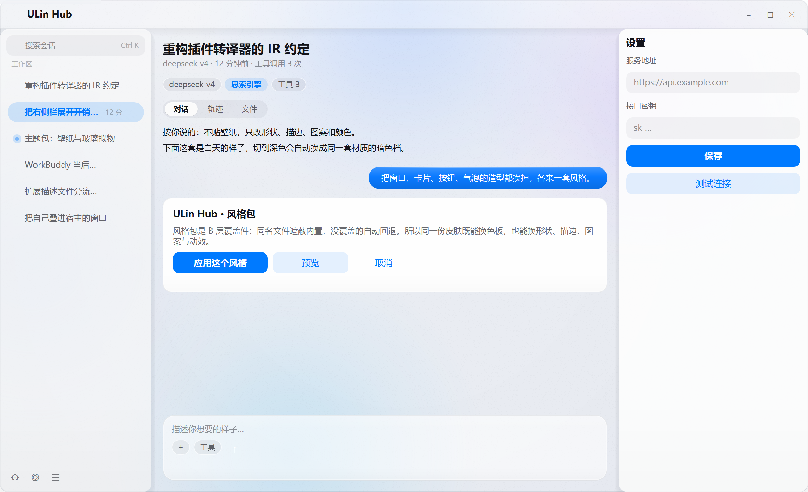
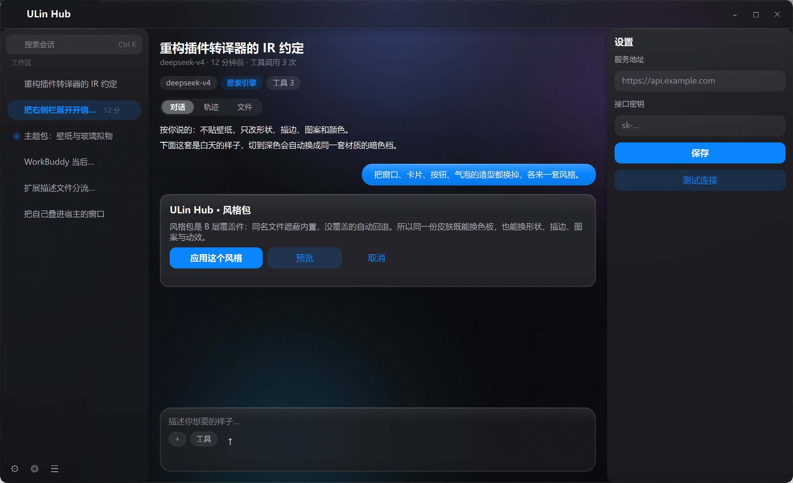

# iOS 玻璃 · iOS Glass

按 Apple 现行设计语言（iOS 26 的 Liquid Glass 材质 + 一贯的 systemColor / SF 版式）重画的一套界面。
它**不改宿主代码**，只是 `<exe>/ui/` 上的增量覆盖：同名文件遮蔽内置件，包里没有的自动回退。





---

## 这套东西是怎么定下来的

先查资料再动手，参考资料分两类，**只信能交叉验证的那一类**：

| 采信 | 出处与理由 |
|---|---|
| 系统色 `#007AFF` / `#FF3B30` / `#0A84FF` / `#FF453A`、`systemGroupedBackground #F2F2F7` | Apple 公开的 systemColor 值，多个来源一致 |
| 44pt 触控目标、列表行 44pt、8pt 栅格、16/20pt 边距 | HIG 长期稳定的硬数值，多份转述完全一致 |
| 文字层级用 `label / secondaryLabel(0.6) / tertiaryLabel(0.3)` 的 alpha，而不是另挑灰色 | 语义色是 HIG 的核心做法，任何一份 HIG 摘录都会讲 |
| 连续圆角（squircle）：半径 ≈ 边长 × 0.222 | 业界公认的 Apple 图标几何参数 |
| "玻璃只用在导航层，不要嵌套玻璃；内容层别上玻璃" | HIG 与 WWDC 的明确口径，几份第三方 skill 都复述同一句 |

**不采信**：某些第三方 iOS 26 skill 里给出的 `frostRadius: 7px / depth: 16 / splay: 6 / lightAngle: -45°`
这类"液态玻璃光学参数"。它们是那几份文档自己拟的近似值，不是 Apple 公开的 API 或文档数值，
拿来做视觉参考可以，当规格抄就会跑偏。所以这套包里的玻璃是**从物理直觉拆出来的四层**（见下），
不是照抄某组数字。

> 一句话结论：**尺寸与颜色抄规格，玻璃自己搭。**

---

## 一改：从"彩色皮肤"回到"淡色系统"

第一版是**斜向彩色主渐变（天蓝 → 淡紫 → 樱粉 → 蜜桃）+ 悬空胶囊导航条 + 全胶囊按钮**。
方向是错的，三个具体症状：

| 症状 | 原因 | 改法 |
|---|---|---|
| 整屏被染色，"像 2013 年的拟物" | 主渐变铺满 100% 面积，峰值又高（0.7~0.9），白玻璃压上去只能变白，透不出层次 | 底色换成**中性冷灰白**，颜色只留在几团大半径、低峰值（≤ 0.5）的**冷色云**里 |
| 面板糊成一片，既不像玻璃也不像卡片 | 所有面板都做成半透明，背景又太淡，明度差只有 10 级 | 内容面板回到**干净白卡片**，玻璃只留给**浮层**（标题栏、输入卡、侧栏） |
| 悬空胶囊 + 重投影，像玩具 | 把 iOS 的**浮层**语言搬到了桌面**顶层窗口**上 | 标题栏恢复**贴边整条**：满宽、无圆角、无投影，靠一条 1px 分隔线 + 下方一层 12px 光晕分层 |

现在的构图是：**大面积中性 + 四角色云**（上：冷蓝，右上：淡鸢尾，下：淡青，左缘：淡蓝）。
中性让界面"干净"，四角的色云保证**每个玻璃件背后都有东西可透** —— 这是玻璃成立的前提，
不是装饰。云的位置是按界面布局定的（标题栏在上、输入卡在下、侧栏在左），不是随手摆的。

---

## 造型要点

### 1. 毛玻璃不是"半透明白块"，是四层叠出来的

`skin/window/Glass.qml` 是这个包的材质件（包内私有件，不是覆盖件）。它把一块玻璃拆成：

| 层 | 做的事 | 为什么必须有 |
|---|---|---|
| ① 折射 | 在自己所在的**窗口坐标位置**，用同一套壁纸算法重画一遍，但 `soften=1.6`（光斑半径放大、峰值压低）+ `canvasSize` 降采样到 1/8 | 玻璃里那团蓝必须正压在外面那团蓝上。错位一点，看上去就只是"半透明色块" |
| ② tint | 色板里的面色（带 alpha），唯一的"填充" | 决定这块玻璃偏白还是偏灰 |
| ③ sheen | 上亮下暗的竖向渐变，亮部只占最上沿 22% | 玻璃的"厚度"。现代玻璃很薄，值压到 0.16 就够，0.40 会变成亚克力板 |
| ④ 边缘 | 顶沿一条两端淡出的横向高光 + **外 1px 淡描边 + 内 1px 白高光**（双描边） | 双描边才会读成"一片玻璃的断面"，单描边只是"一个带框的矩形" |

投影不用 `MultiEffect`，用 8 层递减的圆角矩形近似高斯 —— 宿主允许软件渲染
（`QT_QUICK_BACKEND=software`），那里没有 shader，自绘的影在两种后端下长得一样。
每层浓度系数 0.09（`Glass.qml` 的 `shadowStrength`），8 层叠起来峰值约 0.05，
而且几何是收着的（横向只外扩 0.60 倍半径、上沿不外冒）—— 阴影只负责"离桌面一点距离"，
不负责"描一道黑边"。**参数太厚时只调 `metrics.json` 的 `shadow` 与这个系数，不要改层数。**

### 2. 壁纸是"算出来的"，不是贴图

`skin/window/wallpaper.js` 是壁纸的唯一真源：中性底 + 四团冷色云 + 顶部一道白光。
`Backdrop.qml` 用 `soften=1` 画它当背景，`Glass.qml` 用 `soften=1.6` 画它当"透过玻璃看到的背景"。

关键设计：**底面不再用线性渐变**。线性渐变会让整屏都被"染"上同一个色相，
无论多淡都会显得"这是一张彩色图"。改成"中性底 + 局部色云"之后，界面主体是干净的，
颜色只出现在该出现的地方（标题栏背后、输入卡背后），玻璃才有"透"的意义。

### 3. 形状与版式跟着 iOS 走

- **贴边玻璃条**：标题栏满宽、无圆角、无投影，底部一条 1px 分隔线 + 下方 12px 的
  `scroll edge effect` 光晕（内容从它底下"过"过去）。这是 iOS 26 的做法，
  不是浮在窗口上的胶囊。
- **窗口键**：无底的 32×32 命中区，只有悬停才浮出一层淡灰（圆角 9），图标用
  `Segoe UI Symbol` 细线，关掉那颗悬停变 systemRed 实心。不是 macOS 红绿灯换皮。
- **按钮**：`primary` 实心 systemBlue、`elevated` 淡蓝 tinted（**不是灰底** —— 灰底会读成禁用）、
  `ghost` 纯文字。圆角固定 10，不再做全胶囊：34px 高的胶囊在桌面上会显胖。
  按压只保留 0.985 的微缩 + 一档变深，没有额外图层。
- **分段控件**：`systemFill` 灰胶囊轨道 + 浮起的白色胶囊指示器（暗色是 `#636366`），
  切换用 `Easing.OutBack`（iOS 的弹簧感就是这个过冲）。
- **侧栏选中**：整颗胶囊染 systemBlue 的淡色（0.12）+ 字变蓝。Apple 自家的侧边栏就是这么表达的，
  不加左边条、不加描边。
- **iMessage 气泡**：18px 圆角、无尾巴、systemBlue、白字。
- **聚焦 = 环**：搜索框与表单框静息**无描边**（iOS 的搜索栏没有边，只有底色），
  聚焦才浮出一圈 systemBlue 淡环。
- **输入框 = 浅灰凹槽**：`inputBg` 是 `rgba(15,23,42,0.045)`，不是白色 —— 白底白框在白面板上等于没画。
- **滚动条**：没有轨道，只有一根 6px 圆头棒，滚动/悬停时变实并外扩 2px。

---

## 文件

```
ios/
  pack.json                          uiAbi=3
  theme-light.json / theme-dark.json A 层 74 键色板（由 _build/gen_palettes.py 展开）
  metrics.json                       A 层 几何档位（覆盖层）
  skin/window/wallpaper.js           ★ 私有件：壁纸算法（Backdrop 与 Glass 共用）
  skin/window/Glass.qml              ★ 私有件：材质四层
  skin/window/grain.png              ★ 私有件：96×96 颗粒平铺（压渐变色带）
  skin/window/Backdrop.qml           冷色云壁纸 + 暗角 + 颗粒
  skin/window/TitleBar.qml           贴边玻璃条 + 三颗无底窗口键
  widgets/Card.qml                   分组白卡片（玻璃面 + 双描边 + 柔影）
  widgets/ActionButton.qml           三档平面按钮
  widgets/SegmentedTabs.qml          分段控件
  widgets/PillButton.qml             tinted chip
  widgets/AppScrollBar.qml           细指示棒
  skin/chat/UserBubble.qml           iMessage 气泡
  skin/session/SessionRow.qml        侧栏胶囊行
  skin/session/SessionSearchBox.qml  iOS 搜索栏
  skin/settings/FieldBox.qml         表单框
  previews/*.png                     预览图（不随包发布）
```

`★` 三件是"包内私有件"：宿主本来就支持 C 层（见 `StyleResolver.h` 的注释），
覆盖件的相对 import 按**包目录**解析，所以 `widgets/Card.qml` 能写 `import "../skin/window"`。

---

## 装法

```powershell
Copy-Item -Path "assets\style-packs\ios\*" -Destination "x64\Release\ui\" -Recurse -Force
```

重启客户端。恢复默认：设置 → 外观 → 重置界面包，或删掉 `<exe>/ui` 后重启。

> 覆盖前建议先备份 `x64/Release\ui`。

---

## 调法

- **玻璃更透 / 更雾**：改 `theme-*.json` 里 `panelBg` / `cardBg` / `sessionBarBg` / `composerBg` 的 alpha。
  现在亮色是 0.90 / 0.95 / 0.66 / 0.58，暗色 0.88 / 0.93 / 0.68 / 0.62。
  > 注意分档：**内容面板要不透（0.90+）**，否则文字发飘、层次全塌；
  > **浮层要透（0.58~0.68）**，否则玻璃没有东西可透。这两档的差别就是这套包的骨架。
- **色云更浓 / 更淡**：改 `wallpaper.js` 里 `LIGHT_BLOBS` / `DARK_BLOBS` 的 `a`（峰值）。
  现在 0.26~0.58。超过 0.75 会退回"整屏被染色"的老问题；低于 0.2 玻璃就没东西可透了。
- **玻璃更"厚"**：改 `Glass.qml` 里 sheen 的 4 个 `GradientStop`，或把 `specular` 打开/关掉。
- **圆角/留白/投影**：改 `metrics.json` 的 `radius` / `spacing` / `shadow`（只写要改的键，其余回退内置）。

重出预览：

```powershell
python ..\..\misc\tools\stylepack-render\render_pack.py . light previews\light.png
python ..\..\misc\tools\stylepack-render\render_pack.py . dark  previews\dark.png
```

---

## 已知限制

1. **没有真高斯模糊**。宿主允许软件渲染，`MultiEffect` / `ShaderEffect` 在那里拿不到，所以"模糊"
   是用 ①降采样 + 双线性上采样 ②同源壁纸重绘（`soften`）两件事近似出来的。
   好处是任何后端都成立、且颜色永远对齐；代价是**滚动内容不会被磨砂** ——
   滚动条后面的正文仍然清晰。这是这套包与真 iOS 最大的观感差距。
   也正因为壁纸本身是平滑的，玻璃的"磨砂感"实际来自 `grain.png` 的颗粒透出，而不是模糊。
2. **只有标题栏开折射**。侧栏/卡片如果也开，就得在每次滚动、每次尺寸变化时重画一张画布；
   会话行这种高频复用的件不值这个代价。它们的玻璃感来自 tint / sheen / 双描边 / 投影。
3. **两处颜色不受色板控制**：`basic/chat/Composer.qml` 的输入卡描边（`#E3E5E9` / `#2E3034`）
   和 `basic/chat/AgentBubble.qml` 的气泡底（走 `panelBg`，但气泡本身没有玻璃层）。
   前者颜色本来就中性，后者靠色板 alpha 也能透出壁纸，所以没为它们整体覆盖那两个大文件
   （Composer 有 1331 行，覆盖它等于接管整块输入区，风险远大于收益）。
4. **字体不是 SF**。宿主统一用微软雅黑，`Segoe UI Symbol` 给符号。iOS 的词标质感靠
   字重 600 + 紧字距去贴，不是真 SF Pro。
5. **`Qt.rgba()` 的通道是 0~1**。想写 `#1A1A1F` 必须写 `Qt.rgba(0.102, 0.102, 0.122, a)`；
   写成 `Qt.rgba(26, 26, 31, 0.62)` 会被 clamp 成纯白（1.0），深色标题栏会整条变白 ——
   这个 bug 在第一版里真的出现过。半透明白/黑无所谓（`255` 和 `0` 本来就对应 1 和 0）。
